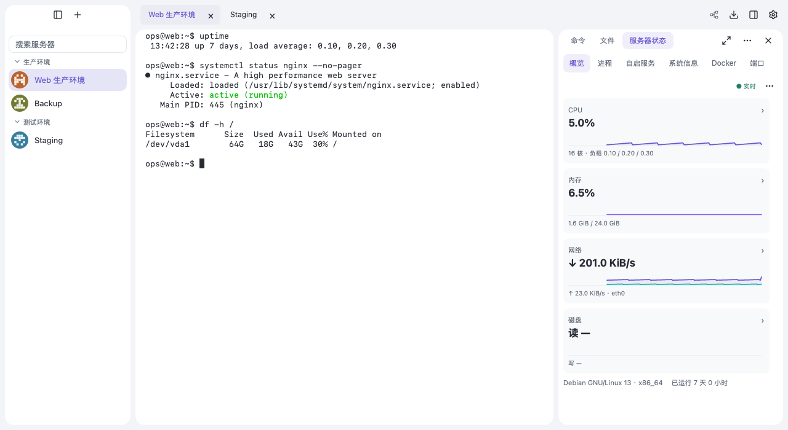
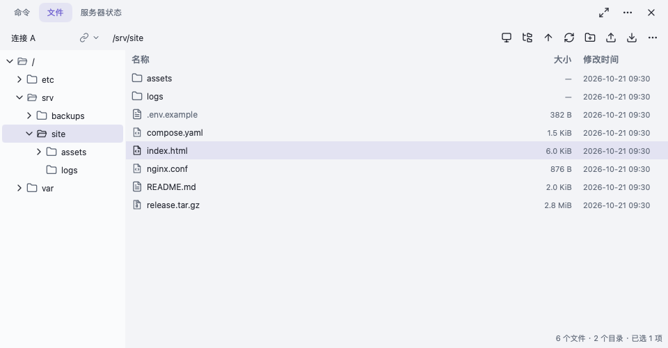
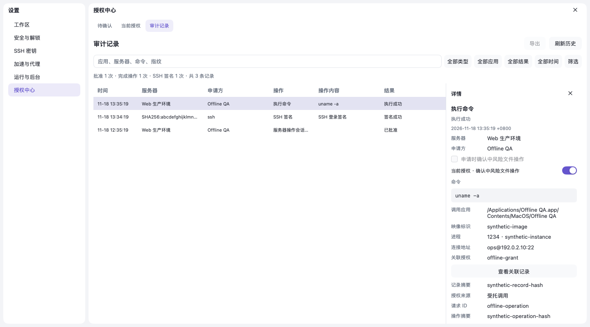

# SmallSSH

A cross-platform SSH workbench: terminal, SFTP file management, server metrics, Docker/Compose, and an AI/CLI proxy with owner-approved operations or time-limited sessions. Native Go + MyGo UI, no account, no hosted credentials. Developer preview, not released.

**English** | [简体中文](README.zh-CN.md)



- **Terminal** — Ghostty rendering (libghostty-vt), tabs and two panes, 32 MiB scrollback, per-connection UTF-8 / GB18030 / GBK and backspace settings
- **Connections** — HTTP(S) / SOCKS5 proxies, pinned SSH relays, handshake measurements, keepalive, and local / remote / dynamic TCP tunnels
- **Hardware keys** — PKCS#11 RSA / ECDSA token discovery and signing; FIDO2 / sk- through SSH agent. Physical device compatibility still needs validation
- **Files** — several tree + list windows, local ↔ server drag and drop, resumable transfers that never overwrite
- **Monitoring** — CPU, memory, network and disk, processes, enabled services, Docker and Compose updates
- **Authority** — approve a time-limited AI/CLI session once; each operation is checked and audited
- **Vault** — master-password encrypted, with Touch ID (Secure Enclave) unlock on macOS
- **Platforms** — macOS, Windows and Linux, plus a CLI over the same broker

<details>
<summary>SFTP and audit screenshots</summary>

**SFTP file manager**



**Authorization and audit**



</details>

## Quick start

```sh
go run ./tools build -platform darwin/arm64   # or linux/amd64, windows/amd64
open build/darwin-arm64/SmallSSH.app          # first launch creates the vault (master password, 12+ bytes)
```

1. Select `＋` in the sidebar to enter the host, user, password or key. Save stores the connection for later.
2. Double-click the saved connection to open a terminal. When prompted, verify the host fingerprint and select *Trust and connect*.
3. *Files* follows the active terminal; *Server status* starts collecting on connect
4. *Approvals* handles AI/CLI requests; *Settings → Security & unlock* enables system verification

Detailed usage: [docs/USAGE.md](docs/USAGE.md). Build, artifacts and CI: [docs/DEVELOPMENT.md](docs/DEVELOPMENT.md).

Connection settings include encoding, proxies and relays. Use *SSH tunnels* from the connection menu to manage forwards. Route measurements compare connection setup time, not throughput; SSH compression is not supported by the pinned SSH library.

## Data

The data directory defaults to `ssh-client-workbench` under the system configuration directory (`~/Library/Application Support/` on macOS, `~/.config/` on Linux, `%AppData%\` on Windows); the desktop app and the CLI both accept `--data-dir` to point at one private directory. `vault.json` is the encrypted connection store, and `audit.jsonl` records only the applicant, server, operation and result — including bounded command/path excerpts and process identity, never passwords, keys, tickets or output. External CLI clients verify the broker against the pairing created by the trusted owner interface. Delegated sessions stay in one live process; restarting requires fresh consent. See [CLI usage](docs/CLI.md). The full list is in [docs/USAGE.md](docs/USAGE.md#数据位置).

## CLI

Once the desktop app unlocks the vault, the CLI talks to the same local broker with the same data directory:

```sh
smallssh hosts
smallssh exec server-id                # guarded: low runs, medium reviewed, high denied; :quit exits
smallssh get server-id /srv/config.txt ./config.txt
smallssh pending && smallssh approve REQUEST_ID
```

Use `smallssh exec server-id 'uname -a'` for a single approved operation. Continuous mode keeps the same CLI process alive; exit, disconnect or restart requires fresh approval. Lines are separate remote commands and do not share `cd` or environment changes. AI integrations can use the JSON-lines `session serve` interface.

Without a desktop session, `smallssh agent` unlocks the shared `smallsshd` backend from one terminal and approvals happen in another. Desktop and CLI use the same backend; only `smallsshd` contains the SSH and proxy runtime. The full command set, delegated sessions and the authorization model are in [docs/CLI.md](docs/CLI.md).

## Documentation

The docs are written in Chinese for now.

| Document | Contents |
|---|---|
| [USAGE](docs/USAGE.md) | Interface, first run, files/terminal/monitoring, data locations |
| [CLI](docs/CLI.md) | Commands, delegated sessions, approvals |
| [ARCHITECTURE](docs/ARCHITECTURE.md) | Layers, threading, IPC, native interop |
| [COMPONENTS](docs/COMPONENTS.md) | UI components and interaction rules |
| [DESIGN](docs/design/DESIGN.md) | Editable desktop design and page map |
| [SECURITY](docs/SECURITY.md) | Trust boundaries for keys, system unlock, approvals and audit |
| [REQUIREMENTS](docs/REQUIREMENTS.md) | Product requirements, delivery status and open items |
| [DEVELOPMENT](docs/DEVELOPMENT.md) | Task entry points, artifacts, dependency upgrades, CI |
| [VERIFICATION](docs/VERIFICATION.md) | Evidence and known limits, appended per round |

## Status

Developer preview, not fully validated on real hardware; the top-level license is not decided yet. Third-party licenses stay in `vendor/`, and the bundle ships a summary at `resources/THIRD_PARTY_NOTICES.txt`.
