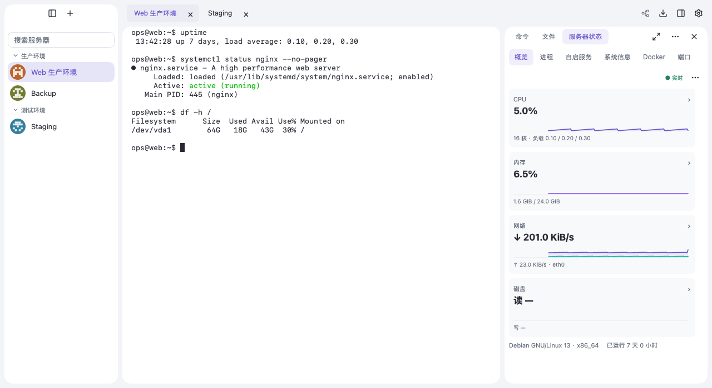
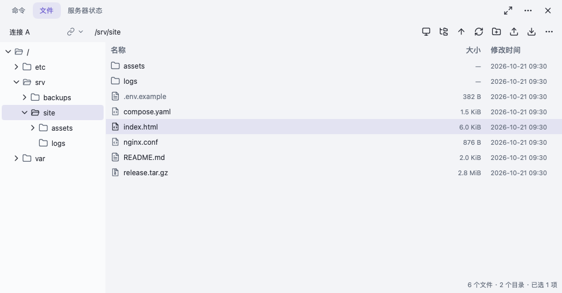
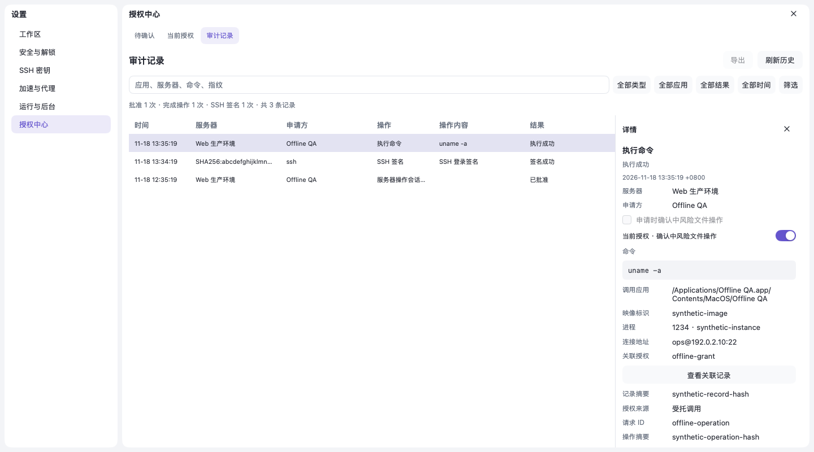

# SmallSSH

[English](README.md) | **简体中文**

跨平台 SSH 工作台：终端、SFTP 文件管理、服务器状态、Docker / Compose，外加一个按操作或有期限会话获得所有者批准的 AI / CLI 代理。Go + MyGo 原生界面，无账号、无凭据托管。开发预览，尚未发布。



- **终端**：Ghostty 渲染（libghostty-vt），多标签、双分栏，32 MiB 回滚；每连接可选 UTF-8 / GB18030 / GBK 与退格序列
- **连接路线**：HTTP(S) / SOCKS5 代理、自有 SSH 中转、握手耗时比较、保活及本地 / 远程 / 动态 TCP 隧道
- **硬件密钥**：PKCS#11 RSA / ECDSA 令牌识别与签名；FIDO2 / sk- 通过 SSH agent，物理设备兼容性待实测
- **文件**：多窗口目录树 + 列表，本机与服务器互拖，断点续传不覆盖
- **监控**：CPU / 内存 / 网络 / 磁盘、进程、自启服务、Docker 与 Compose 更新
- **授权**：AI / CLI 可一次批准有期限的会话，范围内连续操作逐条校验并审计
- **保险库**：主密码加密；macOS 可用 Touch ID（Secure Enclave）解锁
- **平台**：macOS、Windows、Linux，附带同源 CLI

<details>
<summary>SFTP 与审计截图</summary>

**SFTP 文件管理**



**授权与审计**



</details>

## 快速开始

```sh
go run ./tools build -platform darwin/arm64   # 或 linux/amd64、windows/amd64
open build/darwin-arm64/SmallSSH.app           # 首次打开创建保险库（主密码 ≥ 12 字节）
```

1. 从左侧「＋」新建连接，填写地址、用户名和密码或私钥。点「保存」写入连接配置。
2. 双击已保存的连接打开终端。出现身份确认时，核对服务器指纹，再选择「信任并连接」。
3. 「文件」跟随当前终端；「服务器状态」随连接自动采集
4. 「授权中心」处理 AI / CLI 的访问申请；「设置 → 安全与解锁」启用系统验证

详细操作见 [使用说明](docs/USAGE.md)。构建、产物与 CI 见 [开发、构建与发布](docs/DEVELOPMENT.md)。

连接设置可配置编码、代理与中转；连接菜单「SSH 隧道…」管理端口转发。路径比较只测建连耗时，不代表持续带宽提升；当前固定 SSH 库不支持压缩。

## 数据位置

默认在系统配置目录下的 `ssh-client-workbench`（macOS `~/Library/Application Support/`、Linux `~/.config/`、Windows `%AppData%\`）；桌面与 CLI 都用 `--data-dir` 指向同一私有目录。`vault.json` 是加密连接库，`audit.jsonl` 记录申请方、服务器、操作与结果，包含有界命令 / 路径摘录及进程身份，不含口令、密钥、ticket 或输出。完整清单见[使用说明](docs/USAGE.md#数据位置)。

## CLI

桌面端解锁后，CLI 连接同一个本地代理并使用同一数据目录：

```sh
smallssh hosts
smallssh exec server-id                # 连续命令：批准一次，每行一条，:quit 退出
smallssh get server-id /srv/config.txt ./config.txt
smallssh pending && smallssh approve REQUEST_ID
```

需要只执行一次时使用 `smallssh exec server-id 'uname -a'`。连续模式保持同一 CLI 进程；退出、断线或重启后重新批准。每行是独立远端命令，不保留 `cd` / 环境变量；机器调用可用 JSON 行模式 `session serve`。

无桌面时可 `smallssh agent` 在本机起代理、在另一终端审批。命令全集、委托会话与授权模型见 [CLI 与 AI 使用](docs/CLI.md)。

## 文档

| 文档 | 内容 |
|---|---|
| [使用说明](docs/USAGE.md) | 界面、首次使用、文件/终端/监控、数据位置 |
| [CLI 与 AI 使用](docs/CLI.md) | 命令、委托会话、审批 |
| [架构](docs/ARCHITECTURE.md) | 分层、线程模型、IPC、原生接入 |
| [组件](docs/COMPONENTS.md) | UI 组件与交互约定 |
| [桌面设计](docs/design/DESIGN.md) | 可编辑设计源和页面目录 |
| [安全与边界](docs/SECURITY.md) | 密钥、系统解锁、审批与审计的信任边界 |
| [产品需求](docs/REQUIREMENTS.md) | 已交付能力、待办与验收要求 |
| [开发、构建与发布](docs/DEVELOPMENT.md) | 任务入口、产物、依赖升级、CI |
| [验收记录](docs/VERIFICATION.md) | 按轮追加的证据与已知边界 |

## 状态

开发预览，未经实机全面验收；顶层许可证尚未确定。依赖的原有许可证保留在 `vendor/`，随包分发的汇总见 `resources/THIRD_PARTY_NOTICES.txt`。
