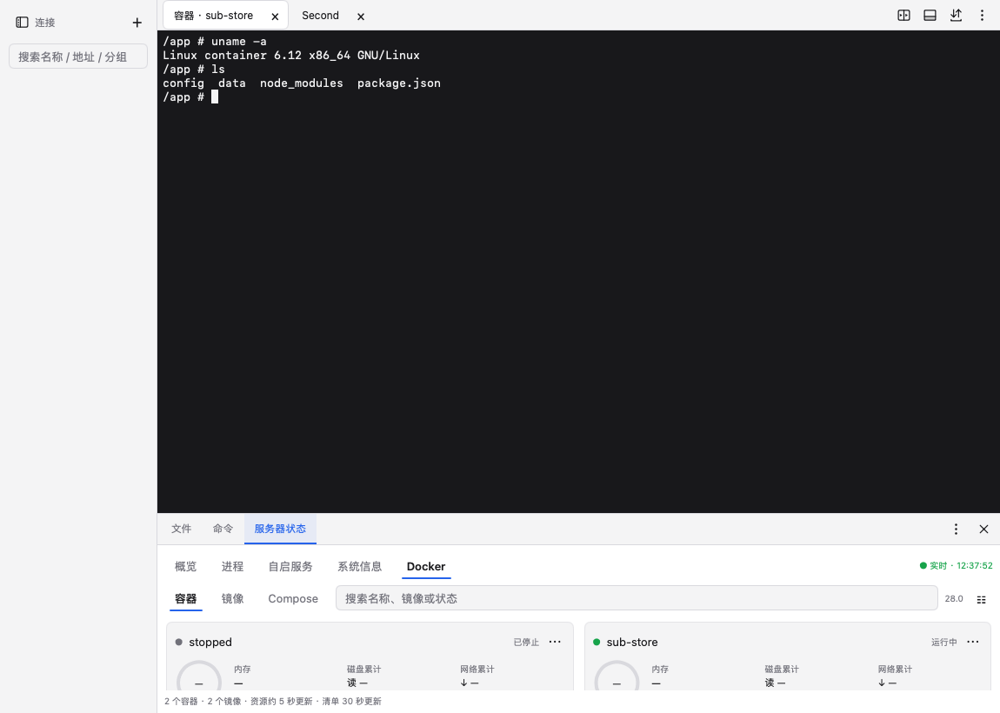

# SmallSSH

[English](README.md) | **简体中文**

跨平台 SSH 工作台：终端、SFTP 文件管理、服务器状态、Docker / Compose，外加一个每次访问都要所有者批准的 AI / CLI 代理。Go + MyGo 原生界面，无账号、无凭据托管。开发预览，尚未发布。



- **终端**：Ghostty 编码与渲染（libghostty-vt），多标签、双分栏，32 MiB 回滚
- **文件**：多窗口目录树 + 列表，本机与服务器互拖，断点续传不覆盖
- **监控**：CPU / 内存 / 网络 / 磁盘、进程、自启服务、Docker 与 Compose 更新
- **授权**：AI / CLI 每次访问都要人工批准，可签发有期限的委托会话，审计可查
- **保险库**：主密码加密；macOS 可用 Touch ID（Secure Enclave）解锁
- **平台**：macOS、Windows、Linux，附带同源 CLI

## 快速开始

```sh
go run ./tools build -platform darwin/arm64   # 或 linux/amd64、windows/amd64
open build/darwin-arm64/SmallSSH.app           # 首次打开创建保险库（主密码 ≥ 12 字节）
```

1. 左侧「＋」新建连接：地址、用户名、密码或私钥。首次保存**只读取主机指纹，不发送凭据**
2. 核对指纹后「信任并连接」进入终端；双击左侧连接每次新开一个终端
3. 「文件」跟随当前终端；「服务器状态」随连接自动采集
4. 「授权中心」处理 AI / CLI 的访问申请；「设置 → 安全与解锁」启用系统验证

详细操作见 [使用说明](docs/USAGE.md)。构建、产物与 CI 见 [开发、构建与发布](docs/DEVELOPMENT.md)。

## 数据位置

默认在系统配置目录下的 `ssh-client-workbench`（macOS `~/Library/Application Support/`、Linux `~/.config/`、Windows `%AppData%\`）；桌面与 CLI 都用 `--data-dir` 指向同一私有目录。`vault.json` 是加密连接库，`audit.jsonl` 只记录申请方、服务器、操作与结果，不含命令、路径、口令或输出。完整清单见[使用说明](docs/USAGE.md#数据位置)。

## CLI

桌面端解锁后，CLI 连接同一个本地代理并使用同一数据目录：

```sh
smallssh hosts
smallssh exec server-id 'uname -a'
smallssh get server-id /srv/config.txt ./config.txt
smallssh pending && smallssh approve REQUEST_ID
```

无桌面时可 `smallssh agent` 在本机起代理、在另一终端审批。命令全集、委托会话与授权模型见 [CLI 与 AI 使用](docs/CLI.md)。

## 文档

| 文档 | 内容 |
|---|---|
| [使用说明](docs/USAGE.md) | 界面、首次使用、文件/终端/监控、数据位置 |
| [CLI 与 AI 使用](docs/CLI.md) | 命令、委托会话、审批 |
| [架构](docs/ARCHITECTURE.md) | 分层、线程模型、IPC、原生接入 |
| [组件](docs/COMPONENTS.md) | UI 组件与交互约定 |
| [安全与边界](docs/SECURITY.md) | 密钥、系统解锁、审批与审计的信任边界 |
| [授权委托](docs/DELEGATION.md) | 子授权、续期与撤销 |
| [功能进度](docs/FEATURES.md) | 已实现 / 未实现 |
| [服务器管理](docs/SERVER-MANAGEMENT.md) | 资源、进程、服务与 Docker 工作流 |
| [服务目录](docs/SERVICE-CATALOG.md) | 服务识别与展示规则 |
| [本地化](docs/LOCALIZATION.md) | 文案与语言切换 |
| [开发、构建与发布](docs/DEVELOPMENT.md) | 任务入口、产物、依赖升级、CI |
| [验收记录](docs/VERIFICATION.md) | 按轮追加的证据与已知边界 |

## 状态

开发预览，未经实机全面验收；顶层许可证尚未确定。依赖的原有许可证保留在 `vendor/`，随包分发的汇总见 `resources/THIRD_PARTY_NOTICES.txt`。
